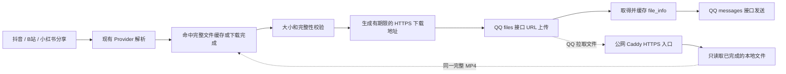

# QQ 官方 Bot 完整文件 URL 发送方案

状态：代码已实施，默认关闭。公网地址尚未配置，QQ URL 拉取仍需真实域名与测试账号验收。

## 目标与约束

抖音、B站、小红书的视频先完整下载为一个本地文件，完成校验后，通过临时公网 HTTPS 地址交给 QQ 的 URL 上传接口。官方视频出口不再调用 `upload_prepare`、分片 PUT、`upload_part_finish` 或上传合并，也不在失败时悄悄回退到分片。

保留现有 Provider、登录态、卡片解析和跨群解析缓存。三平台共用官方媒体出口；NapCat 仍使用现有发送方式。默认保留文件内容，不自动压缩、降清晰度或分成多条消息。

## 已核实的边界

依据 [官方富媒体概述](https://bot.q.qq.com/wiki/develop/api-v2/server-inter/message/rich-media.html) 与 [群聊上传接口](https://bot.q.qq.com/wiki/develop/api-v2/autogen/api/v2_groups_group_openid_files.post.html)：视频软限制 30 MB、硬限制 200 MB，超过软限制降级为文件。二进制直传限制 5M；URL 上传由 QQ 下载并转存，不能绕过媒体大小和展示限制。

当前 AstrBot 的 10 MiB 是本地切换分片的阈值，不是 QQ 默认上传容量。URL 方案绕过此选择分支，无需将阈值调成 200 或 500 MB。实施时统一字节单位；边界未实测前按 200,000,000 字节保守控制官方出口，NapCat 的既有 500 MiB 限制不跟着降低。

30.50 MB 样本：二进制直传返回 HTTP 413；抖音分享页作为 URL 返回 850019 格式不支持；分片上传成功后客户端显示文件卡片。尚未使用真实公网 MP4 地址完成 URL 上传与客户端展示验收。

QQ 需要的是直接返回完整 MP4 字节的地址，例如 `https://media.example.com/official-media/<opaque-id>.mp4?expires=...&signature=...`，不是抖音分享页面。官方参数说明支持以 http 开头的 URL；本方案选 HTTPS 提供加密传输。不能承诺 QQ 内部只发起一次 HTTP 请求，可能重试或使用 Range；我们提供同一个完整文件，不实现本地分片上传。

## 推荐链路

### 1. 完整文件准备

- 增加官方专用的“准备完成文件”步骤，复用正在下载的任务以及已有本地文件。抖音已有预下载机制可复用；小红书直链、B站代理/合并产物统一落实到本地完整文件。
- 下载中使用临时状态，写入结束、大小匹配且 MP4 可读取后才标记 ready 并对外提供。失败或不完整文件不会返回给 QQ。
- 不将每次分享都变成重新抓取源站。同作品、同分 P、同画质复用解析和文件；不同视频内容不能仅按标题复用。
- 记录源站下载、文件准备、QQ 拉取、消息发送四阶段耗时，完整下载较慢时不提前报告发送成功。

### 2. 公网 HTTPS 入口

推荐在现有 Windows 服务器运行 Caddy，使用自有域名及自动续期证书，443 端口仅暴露新增的 `/official-media/` 下载路径。其余路径默认拒绝；8787、Provider、管理后台保持内网访问。

新增下载端点只接受已经登记的本地文件 ID，不接受客户端提供任意源站 URL。链接有随机 ID、签名和到期时间，不包含 QQ API Token、Cookie 或源站签名链接。它不需要浏览器登录、额外请求头或 Cookie，QQ 可直接 GET。

端点提供真实的 `Content-Type: video/mp4`、`Content-Length`、HEAD、GET 和单区间 Range/206/416。当前本地媒体路由虽声明 Accept-Ranges，但没有完整实现 Range 和 HEAD，不能原样映射为正式公网出口。

建议独立配置官方公网根地址，不直接修改全局 `QQ_MEDIA_PUBLIC_BASE_URL`，避免迫使 NapCat 和服务内部请求绕公网。

备选是把完整文件转存到私有对象存储，用短期签名下载 URL。这会新增一次服务器到存储的传输和存储/流量费用，且 SDK 也可能自动分块；第一阶段优先采用本机文件 HTTPS 入口。

### 3. 官方发送

官方 Bridge 先通过内部 Node 地址对同一媒体 ID 做完整文件 `HEAD` 预检，确认本地文件已准备好后，再调用对应群聊或 C2C 的 `/files`：`file_type=2`、`url=<完整文件地址>`、`srv_send_msg=false`，校验取得 `file_info` 后再发送 `msg_type=7` 消息。`/files` 登记阶段允许有限重试，消息发送不盲目重试以避免重复消息。当前代码由 `official_video_url_upload_enabled` 控制；URL 失败不会回退到本地分片路径。

不再把视频先下载到 AstrBot 临时目录，也不将本地 Video 交给自动选择分片的上传函数。其余图片、商人 Markdown 艾特和图集发送不改。

群聊上传和 C2C 上传采用各自端点。素材复用按 Bot 应用、发送场景、文件内容和有效期区分；第一阶段再按目标隔离 QQ `file_info`，跨群素材是否可复用须由接口验证，不凭现有 NapCat 缓存推断。源站解析和完整文件仍可跨群共用。

### 4. 缓存与并发

- 完整文件、正在执行的下载任务和源站解析分别复用，解决同时转发造成的重复工作。
- QQ 返回的 `file_info` 遵从其 ttl，并留提前失效余量；缓存过期时仅重新登记现有文件 URL，不重新抓取源站。
- 建议初始 URL 有效期 60 分钟，从文件准备完毕开始计算；下载和 QQ 拉取期间持有文件使用标记，清理任务不得删除在用文件。
- 现有缓存约 10 分钟、默认容量 512 MiB，不能直接承担多个大视频与 60 分钟拉取窗口。实施前按磁盘余量设置容量、任务并发和最小空闲空间，不足时排队或明确失败。
- 建议初始源站准备并发 2、QQ URL 登记并发 1，可观测后再调优。完整文件超过缓存容量不能触发反复下载，应在准备前发现。
- 文件状态和使用标记需要支持服务重启恢复，或将未完成任务明确置为失败，防止内存媒体 ID 丢失导致已交给 QQ 的 URL 突然失效。

### 5. 失败处理

文件准备失败、地址不可访问、QQ 转存失败、消息发送失败分别记录。先定位失败阶段再重试，不能把任一失败都转为重新下载源站视频。

只对明确可恢复的文件准备/转存错误做有界重试，例如最多 2 次、指数退避；格式错误、大小超限不重试。`/files` 使用 `srv_send_msg=false`，避免登记素材时隐式发送。最终消息发送超时视为“结果未确认”，不自动再次发送，避免重复视频。

URL 上传不可用时明确报错并保留短期完整文件缓存，不回退到本地分片。上线后的回退方式是暂停官方视频发送或修复 URL 入口；恢复旧分片策略需要用户重新选择。

## 改动范围

| 模块 | 计划改动 |
| --- | --- |
| Node 媒体服务 | 官方完整文件准备、任务复用、校验、文件使用标记与持久状态 |
| Node HTTP 出口 | 独立签名文件端点、HEAD/Range、访问结果与字节统计 |
| 官方 Bridge | URL 登记素材与发送、去除官方视频本地分片路径、阶段日志 |
| Windows 部署 | Caddy、域名证书、限定路径反代、运行及恢复脚本 |
| 缓存配置 | 文件容量、保留期限、并发和空间不足处理 |
| Provider / NapCat / 商人 | 保留现有行为；避免用本地旧版本覆盖服务器未提交的商人实现 |

## 实施与验收

1. **公网验证**：确认域名、DNS、443 可达、证书签发条件及磁盘/带宽。部署只提供指定测试 MP4 的入口，验证外部 GET、HEAD、Range 与过期签名。
2. **QQ 验证**：用原 30.50 MB 样本调用 URL 上传，`srv_send_msg=false`，记录服务端实际拉取和返回。再验证小于 30 MB 样本。需要测试账号实发时单独明确发送目标，接口成功不能替代客户端显示验收。
3. **代码实施**：统一官方完整文件准备与 URL 发送；通过三平台模拟及集成测试后，仅对测试范围启用。
4. **上线**：先测试账号，再 913546080 群，最后其他既有官方目标。每步核对当前新分享正常、引用旧链接不触发、商人 Markdown @ 保留。

验收覆盖：三平台各至少一个视频；5 MB 以下、10～30 MB、30～200 MB 与超限；同视频跨群并发；B站不同分 P；缺失 Content-Length；源站断流；签名过期；QQ 拉取超时；文件被清理/服务重启；发送超时不重复；记录中图片读取不受影响。

关键通过标准：官方视频路径对分片接口的调用数为零；QQ 拉取的文件与本地完整文件一致；短时间同视频不重复抓源站；未知发送结果不重发；小于软限制的适配视频与大于软限制的文件卡片符合官方行为。

## 尚需落实的部署条件

可用的媒体域名与 DNS 管理方式、证书和公网入站条件、磁盘容量及允许的出口带宽。没有可用域名时可先完成本地代码和测试，但不能把 URL 发送切到生产并宣称可用。本方案不将任何未验证的公网地址或 500 MB 官方发送能力当作既成事实。
