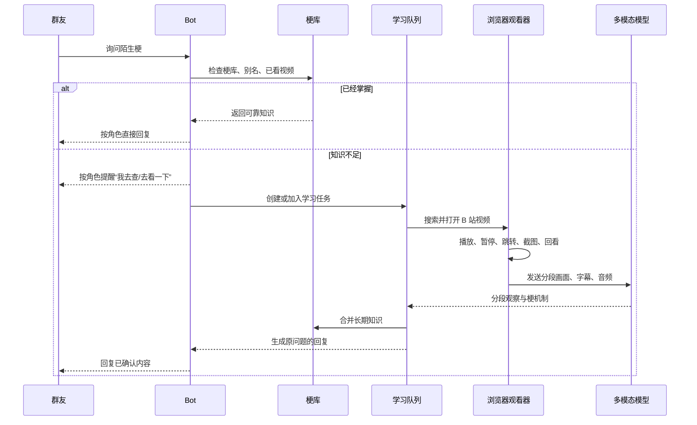

# B 站视频学梗与异步回复一体化方案

> 评论区学习、歌词接续和时事归纳的增强方案见
> [VIDEO_COMMENT_LEARNING_PLAN.md](VIDEO_COMMENT_LEARNING_PLAN.md)。

## 1. 核心目标

让 bot 在遇到未知梗时：

1. 先检查现有梗库和已学习视频。
2. 知识足够就直接回复，不重复学习。
3. 知识不足时，先按当前角色设定提醒用户。
4. 提醒送达后进入等待状态，不提前猜测或正式回答。
5. 后台打开浏览器，逐段观看视频、截图、读取字幕并分析音频。
6. 得到可靠结论后回复原问题，同时把结果写入长期梗库。
7. 查询失败或证据不足时，按角色口吻说明尚未确认，不编造答案。

支持两类任务：

- **按需学习**：用户直接问到陌生梗，或明确要求“去查一下这个梗”。
- **每日补课**：从近期高频但未掌握的公共梗中选择任务，完成后写入梗库并汇总到管理员日报，不打扰普通群聊。

按需学习也支持用户直接指定 B 站视频，不要求梗百科里已有对应词条：

```text
私聊或群里 @bot：学一下这个视频 https://www.bilibili.com/video/BV1aa411c7xx
私聊或群里 @bot：这个视频里的梗学一下 https://b23.tv/AbCdEfG
私聊或群里 @bot：分析一下这个视频 <链接>
```

只有出现“学 / 学习 / 分析 / 拆解 / 弄懂 / 总结”等明确学习意图时才进入视频学习；普通分享“看看这个视频 <链接>”仍走原有媒体解析和分享卡流程。群聊中需要 @bot，或引用 bot 的消息后再发指令。指定链接任务跳过梗百科搜索，直接观看用户给的视频，由模型从视频内容中识别最值得入库的梗。

## 2. 异步消息流程



### 查库阶段

查询顺序固定为：

- 规范梗名和别名。
- 典型台词和画面描述。
- 现有梗知识库、文化短卡和长期视频学习记录。
- 已观看的 BV、CID、分 P 和片段摘要。
- 当前群聊上下文，用来判断已有条目是否真的适用于本次语境。

结果分为：

- **足够回答**：直接回复，不启动学习。
- **部分掌握**：建立缺口任务，只补充缺少的内容。
- **无法确定指代**：先按角色设定澄清，不立即搜索。
- **正在学习**：加入现有任务，不重复启动。

### 提醒和等待阶段

提醒不是固定模板，而是由当前人格、群级人格和用户级口癖共同生成。提醒只说明“正在去查/去看”，不能提前写梗义或暗示结论。

提醒成功发送后：

- 为原消息创建等待记录。
- 暂停该问题的正式回答、猜测和普通接梗。
- 后续相同问题加入同一任务。
- 其他无关话题正常处理。
- 同一群内不重复刷提醒；不同群可共享公共学习任务，但回复上下文隔离。

学习完成后，最终回复要重新结合原问题和当前群聊，而不是直接转发学习笔记。若原问题已经过时，仍应先说明查到的内容，再避免强行接当前新话题。

超时、无字幕、视频打不开、登录失效、模型失败或证据不足时，按照角色风格说明“暂时没确认清楚”，结束等待或提供重新查询入口。

## 3. 浏览器逐段观看方案

### 浏览器职责

新增独立学习浏览器上下文，复用现有 Edge、Playwright 和 B 站登录态，但与普通媒体解析会话隔离。

浏览器只开放必要动作：

- 搜索关键词。
- 打开视频、分 P 和相关页面。
- 读取标题、作者、时长、字幕和播放状态。
- 播放、暂停、跳转、回看。
- 获取当前播放时间。
- 截取播放器画面。
- 记录视频链接和时间戳。

网页标题、弹幕、评论和搜索摘要只能作为线索，不能直接当作视频事实。

### 截图采样策略

采用“浏览器播放 + 时间轴截图”，而不是只下载视频后一次性总结。

默认策略：

- 普通片段每 3～5 秒截图一次。
- 字幕变化时立即补截图。
- 画面变化、人物动作、字幕重点词或快速剪辑时提高频率。
- 模型发现疑似笑点或不确定内容时，回看前后 3～8 秒。
- 每张截图保存准确播放时间。
- 对鬼畜、快速反转和密集字幕片段使用更短间隔。

每个分段形成一份观察包：

```text
视频：BVxxxx，P1
时间：00:32-00:40
截图：按时间排序
字幕：对应字幕或 ASR
音频：对应时间段
OCR：画面文字
任务：解释发生了什么、笑点是什么、哪些元素必须保留
```

### 音频和字幕

截图不能识别破音、变调、语气和音效，因此重点片段必须同时处理音频：

- 优先读取 B 站字幕。
- 无字幕时使用 ASR。
- 对重点时间段提取音频。
- 涉及鬼畜、变调、音效或语气时，将音频送入具备音频理解能力的模型。
- 如果当前模型不支持音频，必须标记为“声音因素未确认”，不能把字幕总结当成完整观看结果。

## 4. 学习内容与长期梗库

每个视频先生成分段观察，再合并成梗条目。条目至少保存：

- 梗名、别名、典型台词。
- 原片、解说和代表性二创来源。
- 关键画面、动作、语气、声音和剪辑节奏。
- 笑点机制：反差、谐音、错位、变调、重复、突然转折等。
- 适用语境、常见接法和不适用场景。
- 二创中可替换和必须保留的元素。
- 视频链接、分 P、片段起止时间和证据类型。
- 已确认内容、模型推断、待核实内容。
- 学习版本、更新时间和纠正记录。

解说视频用于了解背景，原片用于核对出处，二创用于学习实际用法。弹幕和评论只能提供候选线索，不能单独确认来源。

长期视频学习记录独立于现有短期文化缓存，不因缓存过期而重复学习。原始截图、音频和临时媒体默认保留 7 天；知识、时间戳证据和学习记录长期保存。

## 5. 去重与任务调度

### 三层去重

- **知识去重**：同梗不同叫法归并；已足以回答当前语境时不再学习。
- **视频去重**：按 BV、CID、分 P、片段范围和内容摘要识别已观看材料。
- **任务去重**：相同主题和知识缺口只运行一个任务，多个提问共享结果。

新变体、群友纠正或明确要求复核时，只补充新内容。用户询问某个视频的具体内容时，即使梗已经学过，也要重新核对该视频。

### 默认额度

- 全局并发：1 个学习任务。
- 每日新任务：最多 10 个。
- 每日音视频分析：最多 30 分钟。
- 每日补课：最多 3 个任务、10 分钟素材。
- 单任务：最多 3 个来源、5 分钟分析素材、20 次模型调用。
- 用户等待：从首次入队起最多 10 分钟。
- 自动重试：最多 2 次，失败后冷却 24 小时。

按需学习优先于每日补课。额度耗尽后停止新学习，但已有梗库仍可正常检索。

每日补课默认在北京时间 03:00 执行，从最近 24 小时反复出现且尚未掌握的公共梗中选取；完成情况、失败原因、处理时长和新增条目写入管理员日报。

## 6. 系统接口与部署

Node 服务负责：

- 梗库查询和学习缺口判断。
- 创建、合并和恢复学习任务。
- 保存等待状态。
- 持久化视频学习知识。
- 生成提醒和最终回复。
- 记录通知、结果和消息回执。

独立学习进程负责：

- 浏览器控制。
- 截图和时间轴记录。
- 字幕、OCR、ASR 和音频切片。
- 多模态模型调用。
- 分段总结和证据返回。

Bridge 负责：

- 发送人格化查询提醒。
- 轮询待发送的提醒和最终结果。
- 回报消息 ID 和发送状态。
- 处理进程重启后的未完成投递。

新增持久接口至少包括：

- 学习任务创建和状态查询。
- 待发送通知领取。
- 通知发送回执。
- 管理员重试、暂停和查看来源。

进入查询等待时，消息响应必须显式带有 `learning_pending` 状态，禁止因普通回复流程超时而回落为猜测回答。

学习模型单独配置模型、接口、密钥、超时和额度；普通群聊模型配置不改变。

## 7. 测试与验收

### 异步流程

- 已学梗不提醒、不创建学习任务。
- 未学梗先提醒，再开始查询。
- 查询期间不出现正式猜测回复。
- 相同问题合并任务，不重复提醒。
- 不同群共享知识但不串群聊上下文。
- 重启后等待任务和待发送消息可恢复。
- 通知失败、结果回执不确定、超时和模型失败都能正确收尾。

### 浏览器观看

- 能搜索、打开、播放、暂停和跳转。
- 截图时间戳与播放位置一致。
- 字幕变化和画面变化会提高采样密度。
- 模型不确定时能回看指定片段。
- 截图、字幕和音频能按时间正确对应。
- 只含视觉笑点的视频可以理解。
- 涉及破音、音效和变调的视频不会在未分析音频时被标记为已完全理解。

### 梗库与效果

- 相同 BV、不同分享链接和已看片段不会重复处理。
- 新变体只补充缺失知识。
- 长期学习记录不会被短期缓存清理。
- 梗条目包含时间戳证据。
- 在未见过的新群聊语境中能正确解释和适度使用。
- 无法确认出处或笑点时会保留不确定性，不编造结论。

第一阶段先实现完整闭环：**查库 → 人格化提醒 → 等待 → 浏览器播放和截图 → 字幕/音频分析 → 梗库入库 → 回复原问题**。完成离线样本验收后，再启用每日补课。
